# Zmiany na stronie grafit-fitness.pl — do akceptacji

Data: 21.11.2026

Wprowadzamy kilka drobnych zmian, żeby ze strony mogły wygodnie korzystać także osoby niewidome, słabowidzące i te, które poruszają się po stronie klawiaturą zamiast myszką — tego wymagają przepisy o dostępności. Treść strony (opisy, ceny, zajęcia) zostaje taka sama.

Na każdym zrzucie po lewej jest strona dziś („Przed”), po prawej — po zmianach („Po”). „Telefon” i „komputer” mówią, na jakim urządzeniu zrobiono zrzut; „bardzo wąski ekran” to najmniejsze telefony (szerokość 320 punktów).

## Do decyzji

Każdą zmianę można przyjąć albo odrzucić osobno. W dwóch sprawach prosimy o wyraźną decyzję.

### A. Na telefonie w nagłówku samo logo, bez napisu „GRA-fit Fitness”

| Przed | Po |
|---|---|
|  | 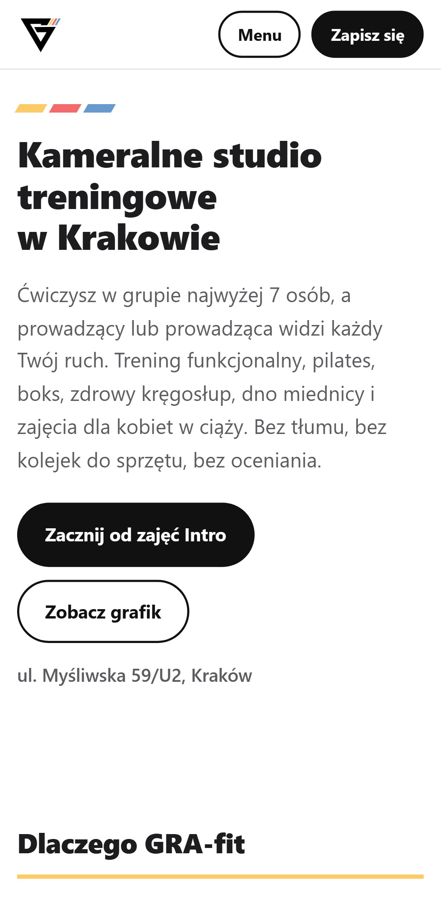 |

- **Co się zmienia:** na większości telefonów (węższych niż 480 punktów, czyli zwykle 360–430) w nagłówku zostaje samo logo, a obok pojawia się nowy przycisk „Menu”. Na dużych telefonach w poziomie, tabletach i komputerach napis zostaje.
- **Dlaczego:** obok logo stoją teraz dwa przyciski, „Menu” i „Zapisz się”. Razem z napisem nie mieszczą się w jednej linii. Nazwa studia nadal jest czytana osobom niewidomym przez ich program czytający ekran, a logo dalej prowadzi na górę strony.
- **Jeśli Pani się nie zgodzi:** napis zostaje, a miejsce zrobimy inaczej — np. mniejszą literą napisu albo przyciskiem „Menu” w postaci samej ikonki (trzy kreski) zamiast słowa. Taką wersję przygotujemy i pokażemy na nowym zrzucie.

- [ ] Akceptuję  - [ ] Nie akceptuję — uwagi: ____

### B. Cennik jako dodatkowy przystanek klawisza Tab na komputerze

| Przed | Po |
|---|---|
|  | 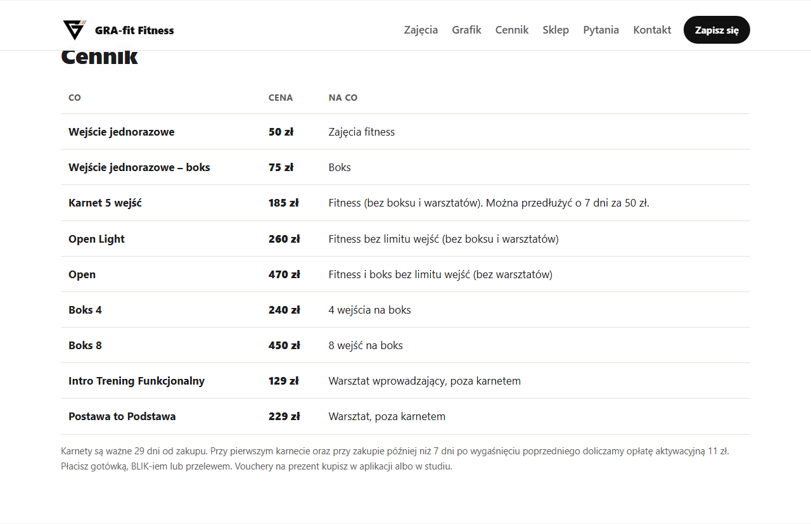 |

- **Co się zmienia:** kto przechodzi po stronie klawiszem Tab, zatrzyma się raz na tabeli cennika — tabela dostaje wtedy czarną ramkę, taką samą jak przyciski (zrzut „Po”). Dziś ten sam krok klawiszem Tab omija cennik i przeskakuje od razu do sklepu, więc w cenniku nie widać żadnej ramki (zrzut „Przed”). Myszką i palcem tej ramki nie widać.
- **Dlaczego:** na telefonie tabela jest szersza niż ekran i trzeba ją przesuwać w bok. Żeby dało się to zrobić klawiaturą, tabela musi umieć „złapać” Tab. Na komputerze tabela się mieści, ale ten przystanek zostaje, bo to ten sam kod strony.
- **Jeśli Pani się nie zgodzi:** na telefonie tabeli nie da się przesunąć klawiaturą — część cen może być wtedy niedostępna dla osób bez myszki i bez dotyku.

- [ ] Akceptuję  - [ ] Nie akceptuję — uwagi: ____

## Pozostałe zmiany

### Nagłówek i menu

**Menu na telefonie**

| Przed | Po |
|---|---|
| 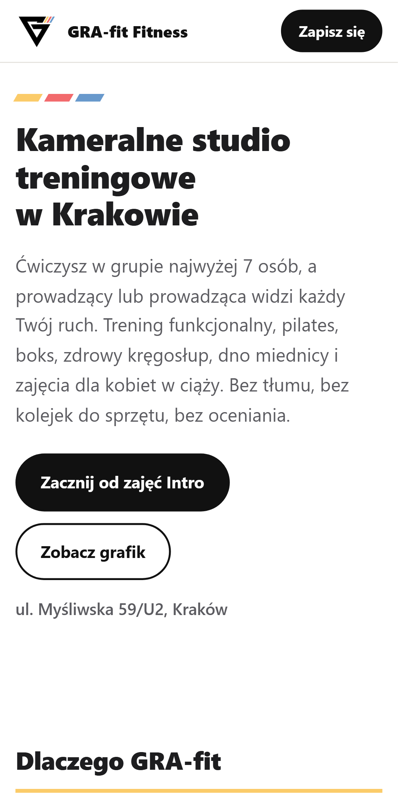 | 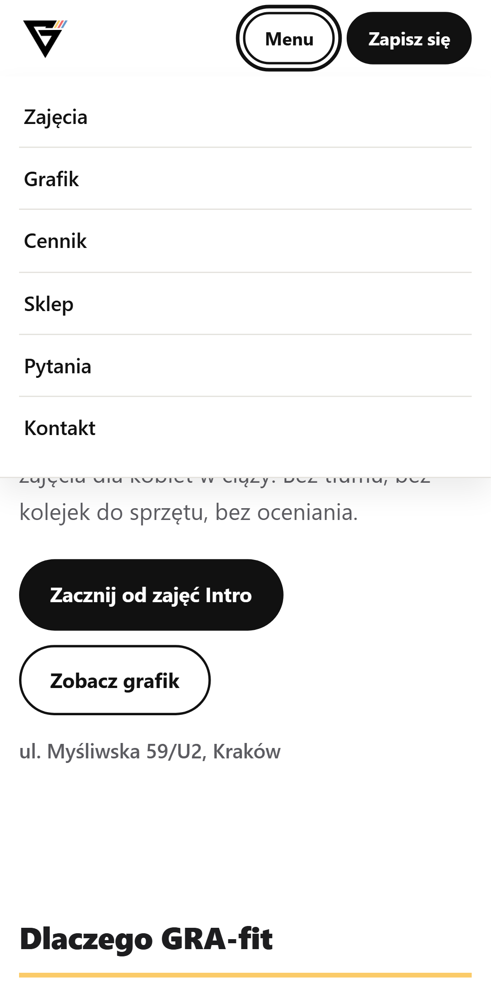 |

Dziś na telefonie menu (Zajęcia, Grafik, Cennik…) jest schowane i nie da się go otworzyć — zrzut „Przed” wygląda jak zwykły nagłówek. Po zmianie przycisk „Menu” rozwija listę sekcji; po wybraniu sekcji lista sama się zwija. Przycisk ma ten sam styl co inne przyciski strony.

### Przechodzenie klawiaturą

**Ramka wokół wybranego przycisku — komputer**

| Przed | Po |
|---|---|
|  | 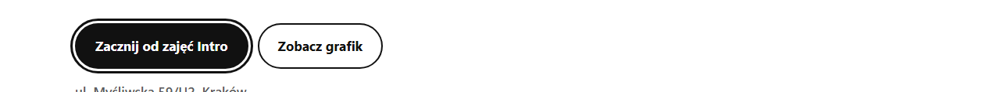 |

**Ramka wokół wybranego przycisku — telefon**

| Przed | Po |
|---|---|
| 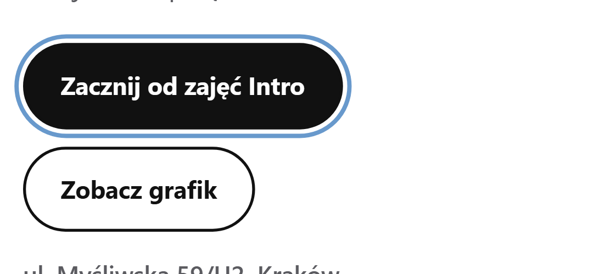 | 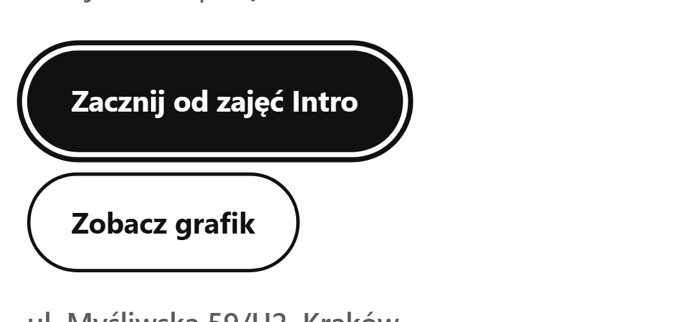 |

Gdy ktoś przechodzi po stronie klawiszem Tab, wybrany przycisk dostaje ramkę, która pokazuje, gdzie jest. Dotąd była jasnoniebieska i słabo widoczna dla osób słabowidzących. Teraz jest czarna, w kolorze logo (w stopce — biała). Myszką i palcem tej ramki się nie widzi.

**Pierwsze naciśnięcie Tab — komputer**

| Przed | Po |
|---|---|
| 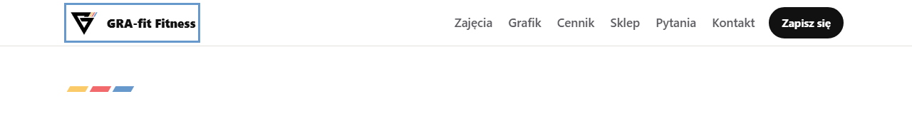 | 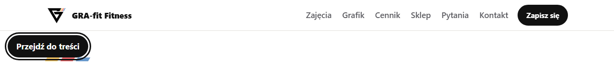 |

**Pierwsze naciśnięcie Tab — telefon**

| Przed | Po |
|---|---|
| 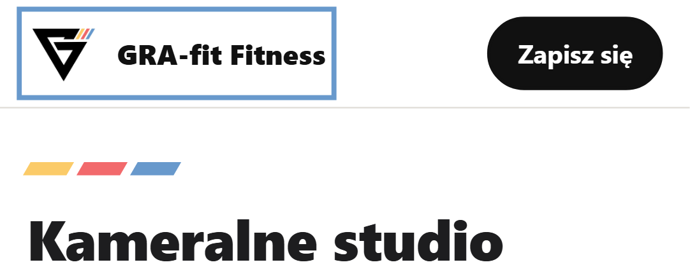 | 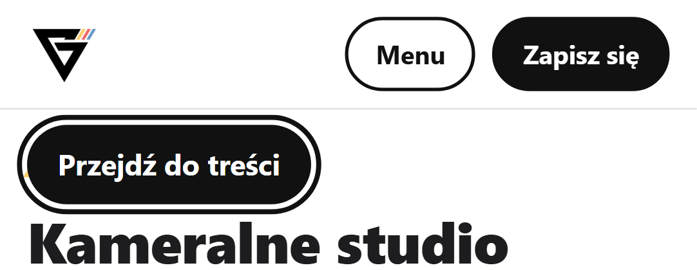 |

Nowy link „Przejdź do treści” pojawia się tylko u osób korzystających z klawiatury, po pierwszym naciśnięciu Tab: czarny przycisk tuż pod nagłówkiem. Pozwala ominąć menu i od razu przejść do treści. Zwykły gość strony go nie zobaczy. Na zrzucie z telefonu widać też nowy przycisk „Menu” (punkt A).

### Grafik

**Grafik — komputer**

| Przed | Po |
|---|---|
| 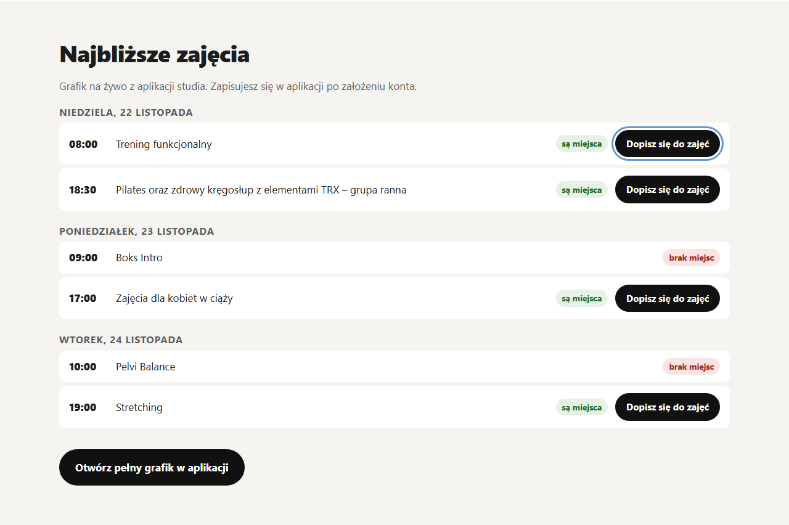 | 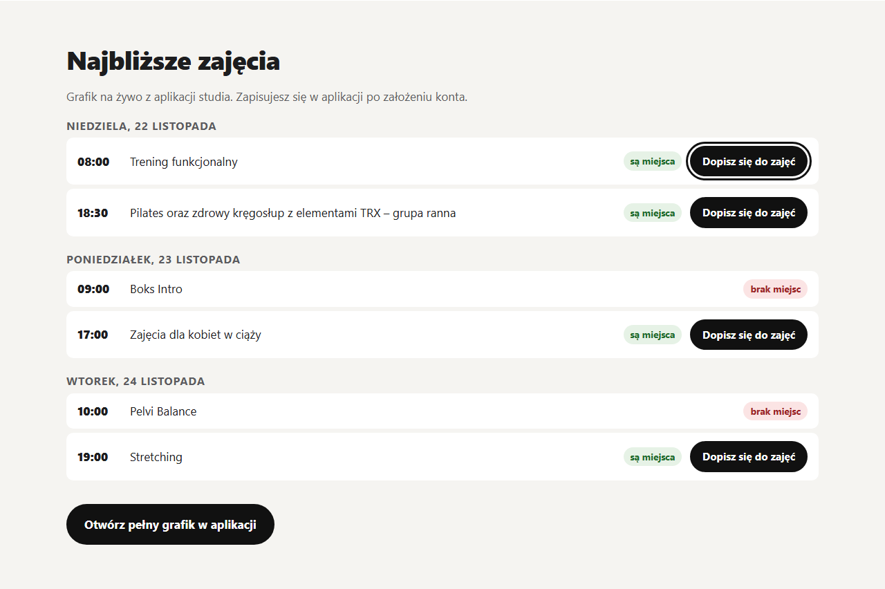 |

**Grafik — telefon**

| Przed | Po |
|---|---|
| 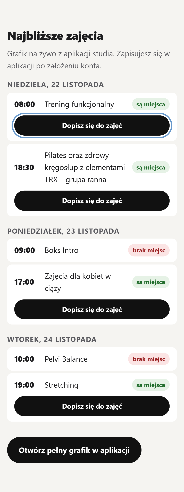 | 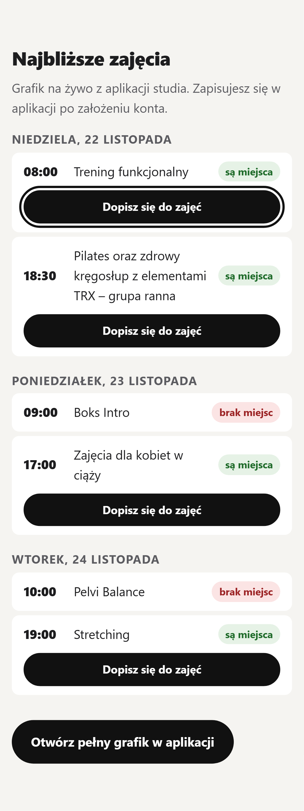 |

Grafik wygląda tak samo; zmienia się tylko ramka wokół wybranego klawiszem Tab przycisku „Dopisz się do zajęć” — z jasnoniebieskiej na czarną, lepiej widoczną.

**Grafik na bardzo wąskim ekranie — komputer z wąskim oknem**

| Przed | Po |
|---|---|
| 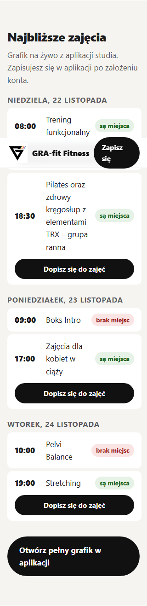 | 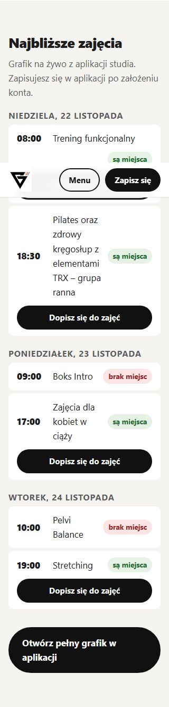 |

**Grafik na bardzo wąskim ekranie — telefon**

| Przed | Po |
|---|---|
| 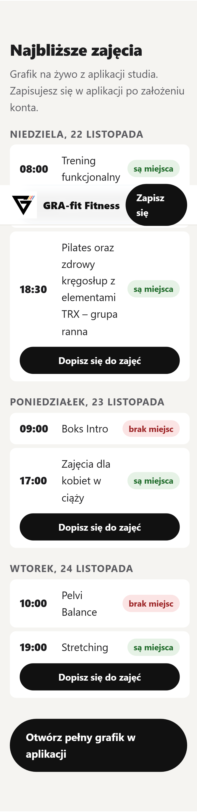 |  |

Na bardzo wąskim ekranie przy niektórych zajęciach (np. „Trening funkcjonalny”) napis „są miejsca” przechodzi pod nazwę zajęć, dzięki czemu nazwa mieści się w jednej linii. Poza tym grafik wygląda tak samo. Gdy ktoś ma w telefonie powiększony tekst, napisy „są miejsca” i „Dopisz się do zajęć” mogą przejść do drugiej linii zamiast wychodzić poza ekran. W nagłówku widać przycisk „Menu” i samo logo (punkt A).

### Cennik

**Cennik — telefon**

| Przed | Po |
|---|---|
| 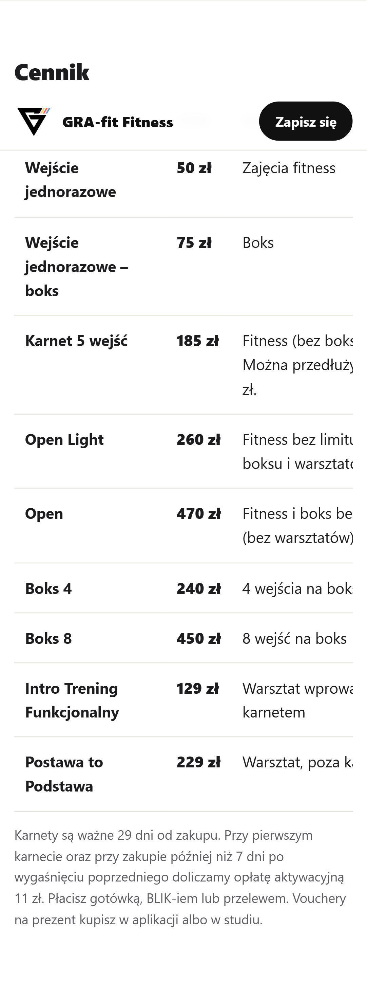 | 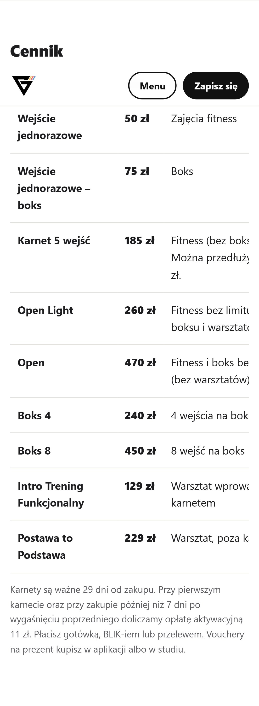 |

Tabela cennika wygląda tak samo. Tabelę, która na telefonie przesuwa się w bok, da się teraz przesuwać także strzałkami na klawiaturze, a program czytający ekran mówi, że to „Cennik”. Jedyna widoczna różnica na zrzucie to nagłówek strony: przycisk „Menu” i samo logo (punkt A).

### Kontakt

**Kontakt na bardzo wąskim ekranie — komputer z wąskim oknem**

| Przed | Po |
|---|---|
| 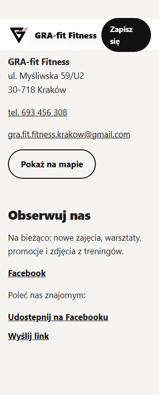 | 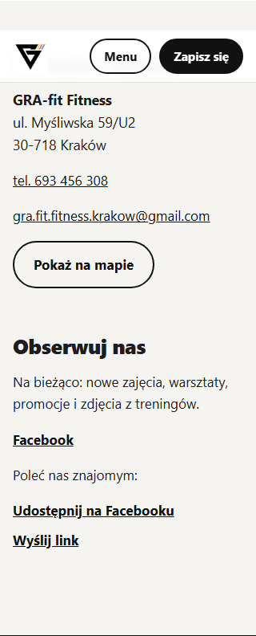 |

**Kontakt na bardzo wąskim ekranie — telefon**

| Przed | Po |
|---|---|
| 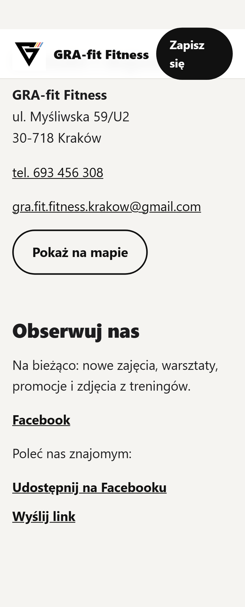 | 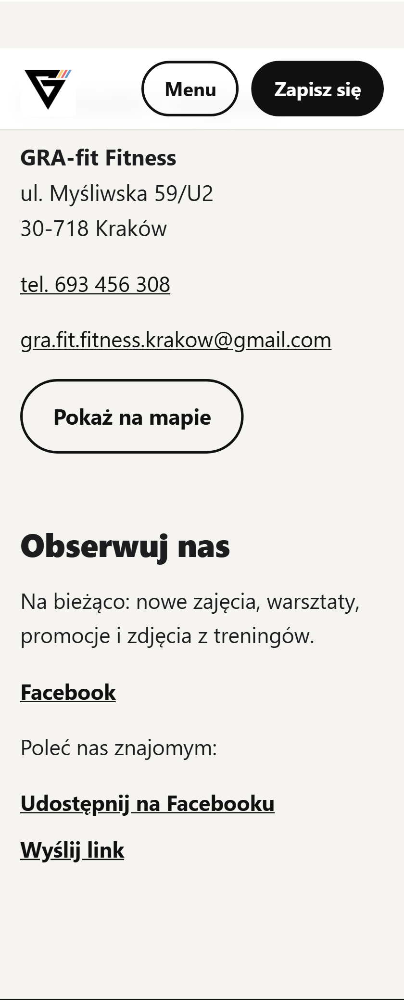 |

Sekcja Kontakt wygląda tak samo jak dotąd. Zmiana działa dopiero przy powiększonym tekście na wąskim telefonie: adres e-mail przechodzi wtedy do drugiej linii zamiast wychodzić poza ekran. Na zrzucie widać tylko nowy nagłówek: przycisk „Menu”, samo logo i „Zapisz się” w jednej linii (punkt A).

### Bez zmian (dla porównania)

**Nagłówek — komputer**

| Przed | Po |
|---|---|
|  | 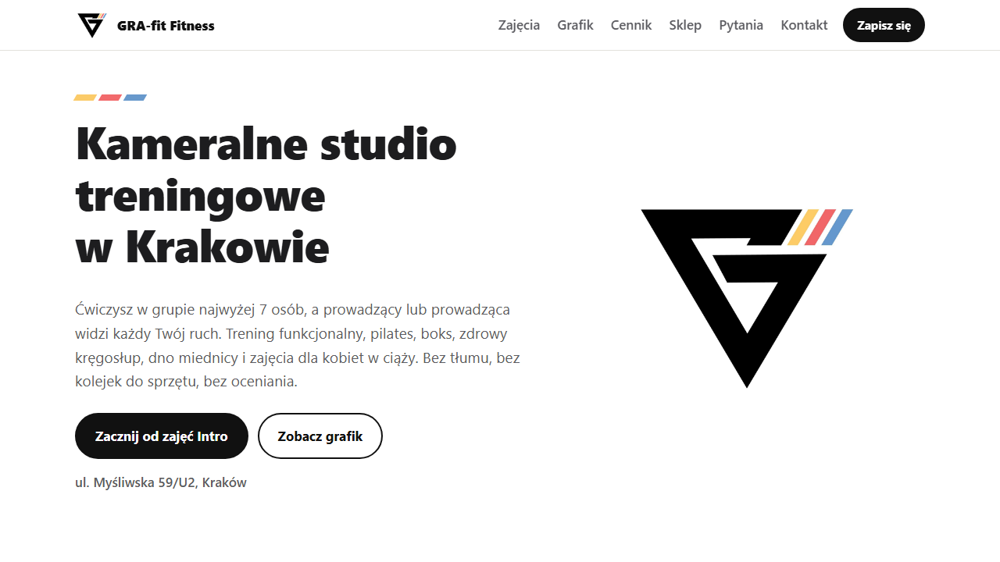 |

Wygląd bez zmian — na komputerze nagłówek zostaje taki, jak był (oba zrzuty są identyczne).

## Czego nie widać na zrzutach

Część zmian słyszą tylko osoby niewidome, które korzystają z programu czytającego ekran na głos. Po kliknięciu „Wyślij link” w sekcji Kontakt na komputerze napis „Link skopiowany” pojawia się teraz pod przyciskiem, a przycisk dalej nazywa się „Wyślij link” — dzięki temu program przeczyta ten komunikat (na telefonie nadal otwiera się okno udostępniania). Tabela cennika jest przez program przedstawiana jako „Cennik”, a link „Przejdź do treści” jest pierwszą rzeczą, którą usłyszy osoba poruszająca się klawiaturą.

## Akceptacja

Prosimy o decyzję **do 4.12.2026**. Każdą zmianę można przyjąć albo odrzucić osobno — wystarczy zaznaczyć wybór przy punktach A i B i dopisać uwagi do pozostałych zmian, jeśli są.

Podpis: ______________________  Data: ______________

---

## Dla zespołu

- `telefon-naglowek` (A), `telefon-menu` → S4a (menu na telefonie, dobra praktyka poza AA).
- `komputer-cennik` (B), `telefon-cennik` → S7 (2.1.1, 1.4.10: `.tabela-owijka` z `tabindex="0"`, `role="region"`, `aria-labelledby`). Zrzuty `komputer-cennik`: po kroku Tab z „Otwórz pełny grafik w aplikacji”; na `main` fokus trafia na `button.sklep__grupa` w `#sklep`.
- `komputer-fokus-przycisk`, `telefon-fokus-przycisk`, `komputer-grafik`, `telefon-grafik` → S1 (1.4.11, obrys `:focus-visible` `--czarny`, w stopce `#fff`).
- `komputer-pierwszy-tab`, `telefon-pierwszy-tab` → S4b (2.4.1, „Przejdź do treści”).
- `komputer-320-grafik`, `telefon-320-grafik`, `komputer-320-kontakt`, `telefon-320-kontakt` → S8 (1.4.10, 1.4.12: zawijanie `.grafik__zapis`, `.grafik__stan`, `overflow-wrap: anywhere` dla e-maila).
- „Link skopiowany” (bez zrzutu) → S3 a (4.1.3).
- `komputer-naglowek` — kontrola: identyczne pliki (ten sam md5).
